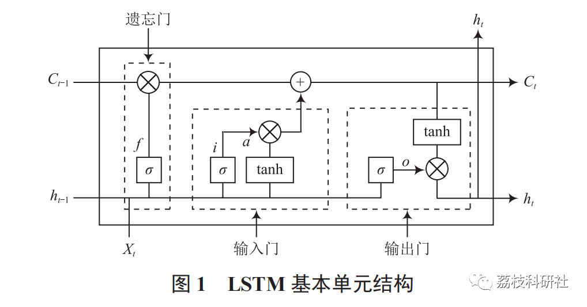
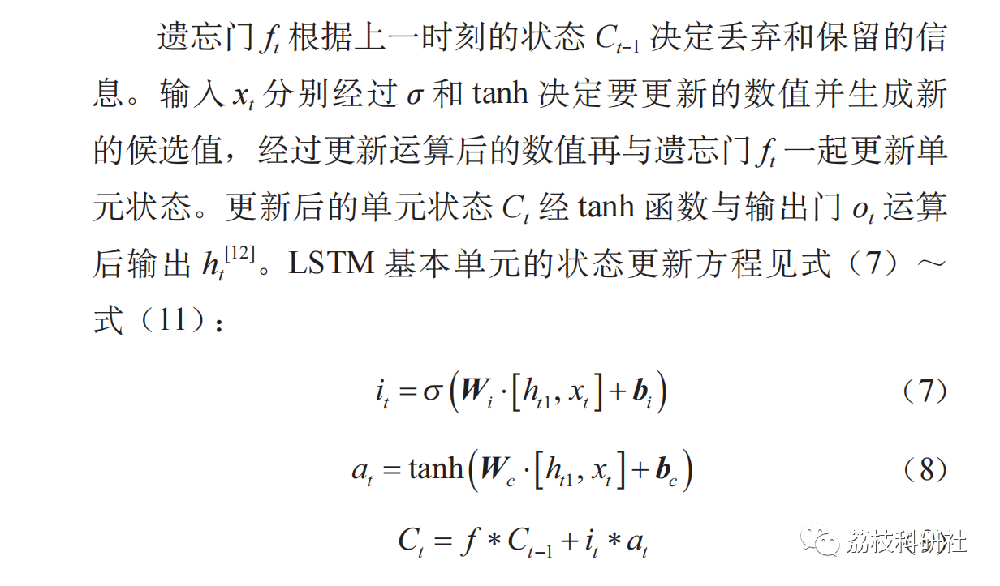
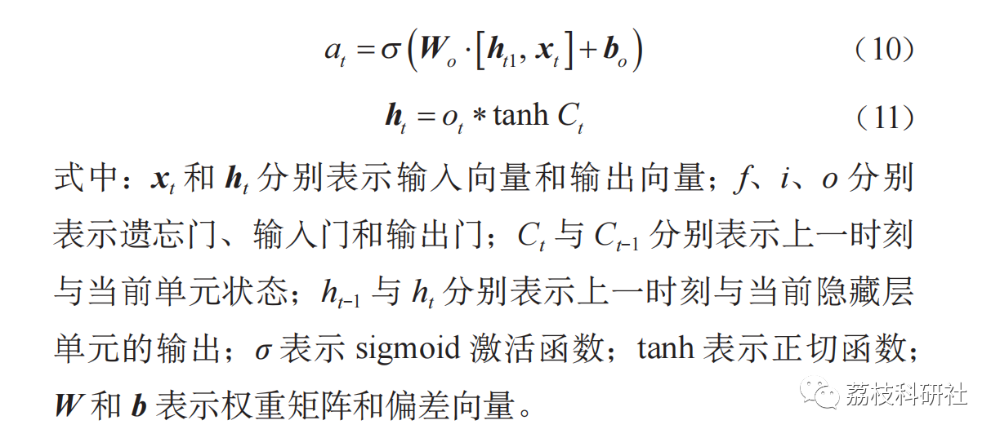
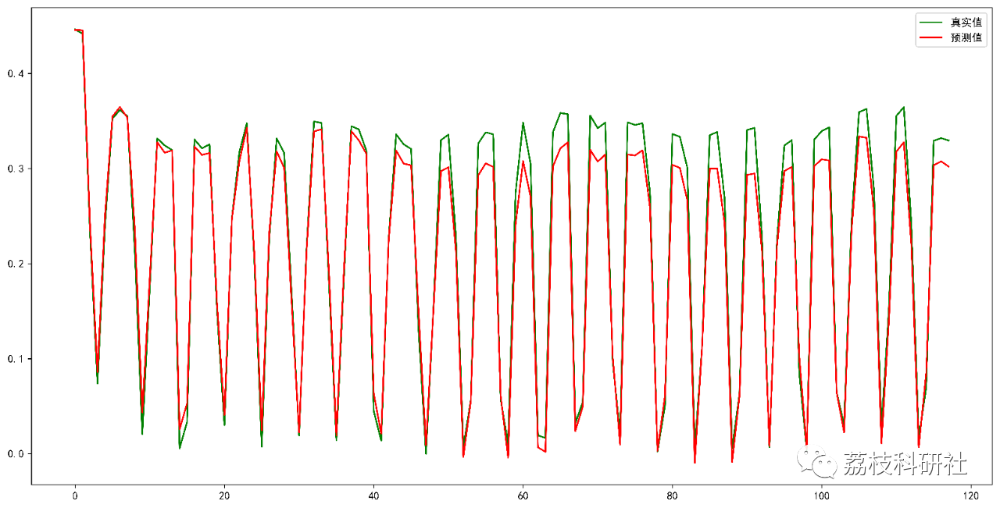
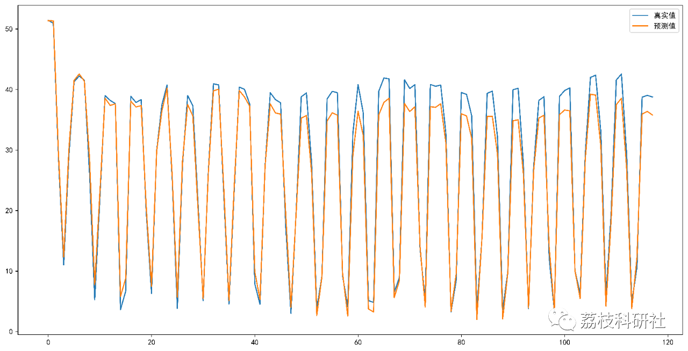

# Power Load Forecast Based on LSTM Long Short-Term Memory Network (Python Code Implementation)

💥💥💥💞💞💞💞 Welcome to this blog❤️❤️❤️💥💥💥
🏆 Bloggers' Advantage: 🌞🌞🌞 The content of the blog strives to be rigorous in thought and clear in logic, for the convenience of readers.
⛳️ Mantra: The journey of a hundred miles is half done in the last ninety.
Litchi Research Society
Code Collection: Power System, Intelligent Algorithms and Applications, Neural Network Prediction, Path Planning, Optimized Scheduling, Workshop Scheduling, Image Processing, Signal Processing...
🎁Column Directory Link:
🌈🌈🌈🌟🌟🌟Electrical Code Intelligent Algorithm and Its Application Path Planning Neural Network Predictive Optimization Scheduling Image Processing Workshop Scheduling Signal Processing Romantic Her My Philosophical Thoughts Math Modeling Complete Code Matters
💥1 Overview
The stable operation of power systems requires the demand for electricity generation and load to achieve dynamic balance. However, the nonlinear characteristics of power loads are pronounced, and their fluctuations are random, with multiple factors affecting the consumption of power loads, especially meteorological factors. Research has shown that an error of 1% in electricity load forecasting can increase the annual operational costs of the power system by several hundred million yuan [1]. Therefore, it is urgent to explore the changing patterns of power loads and improve the prediction accuracy of power loads.
📚2 Long-term and Short-term Memory Networks
The LSTM neural network can effectively avoid the problems of vanishing gradients and exploding gradients in traditional networks. By adding additional memory units, LSTM is capable of remembering past information for long-term storage. The generalization capability of LSTM is strong, it has good learning ability on both large and small datasets, and it has obvious advantages in handling nonlinear problems. The basic unit structure of LSTM is shown in Figure 1.
🎉3 References
[1] Wu Ding'an, Zhong Jianwei, Wang Xinlei, Xiang Jiaguo, Zeng Fanwei, Hu Kai, Chen Chen. Principal Component Analysis and Long-Short Term Memory Networks for Electricity Load Forecasting [J]. Internet of Things Technology, 2021, 11(08):47-51. DOI: 10.16667/j.issn.2095-1302.2021.08.015.
[1] Wang Ji, Li Runqing, Liu Xin, Cao Wanshui, Wang Hao, Chen Yong. Short-term load Forecast Based on Improved Long Short-Term Memory Network [J]. Electrical Automation, 2022, 44(04):61-63.
👨‍💻4 Running Results
👨‍💻5 MATLAB Code Implementation
Click the article's lower left corner to read more
Or reply with keyword: Power Load Forecast Based on Long Short-Term Memory Network

## Images

<!-- PAYMENT_BLOCK -->

## Get this dataset

- Payment link (Stripe): [Buy now](https://buy.stripe.com/3cs8yP7sY87d0vu9AB)
- Payment QR code: 

<!-- /PAYMENT_BLOCK -->
